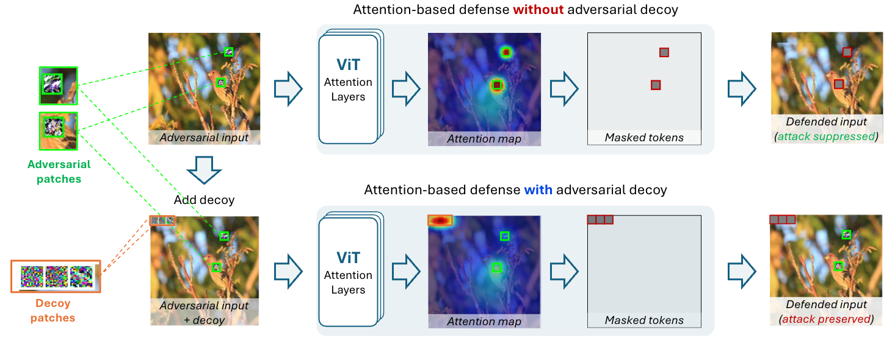

# Adversarial Decoys: Misdirecting Attention-Based Defenses in ViT

Official code for the paper *Adversarial Decoys: Misdirecting Attention-Based Defenses in ViT* (WACV 2027).



We propose adversarial decoys: separate patches optimized only to attract the attention that possible defenses use to flag and mask adversarial attacks. The defense then masks the decoy instead of the attack, and the adversarial prediction survives (bottom row of the figure).
 
This repository contains the core implementation of the method (Patch-Fool attack, decoy optimization and the ARMRO defense) and a demo notebook that runs the full pipeline on a single image.

## Installation

```bash
python -m venv .venv
source .venv/bin/activate
pip install -r requirements.txt
```

The code was tested with Python 3.10. The pretrained `vit_small_patch16_224` weights are downloaded by timm on first use.

## Quickstart

The `notebooks/demo.ipynb` contains an example of how the overall attack and decoy pipeline works.

To use the iteration counts of the paper (500 Patch-Fool steps, 2500 decoy steps), set `PAPER_SETTINGS = True` in the parameter cell.

## Pipeline

| Step | Function | File |
|---|---|---|
| ViT forward that returns all attention maps | `vit_forward_with_attention` | `advdecoy/models/vit.py` |
| Patch-Fool attack (optionally with random token-masking EOT) | `optimize_patch_fool` | `advdecoy/attacks/patch_fool.py` |
| Decoy placement and optimization | `sample_decoy_tokens`, `optimize_attention_decoy` | `advdecoy/attacks/decoy.py` |
| ARMRO defense | `evaluate_armro_defense` | `advdecoy/defenses/armro.py` |

Image tokens are indexed on the patch grid, `token = row * grid_size + col`, from 0 to `grid_size**2 - 1`. In attention maps the same token is at index `token + 1`, because index 0 is the CLS token.

To run the demo on another image, set `IMAGE_PATH` in the parameter cell, and set `LABEL` to its ImageNet class or to `None` to attack the clean prediction (as for `assets/coffee.png`).

## Citation

```bibtex
@InProceedings{Marchiori_2027_WACV,
    author    = {Marchiori Pietrosanti, Giulia and Rossolini, Giulio and Buttazzo, Giorgio},
    title     = {Adversarial Decoys: Misdirecting Attention-Based Defenses in ViT},
    booktitle = {Proceedings of the Winter Conference on Applications of Computer Vision (WACV)},
    month     = {January},
    year      = {2027}
}
```

## License

The code is released under the [MIT License](LICENSE). The example images are not covered by this license (see below).

## Credits

`assets/ILSVRC2012_val_00029267.JPEG` is an image from the ILSVRC 2012 (ImageNet) validation set, included for research and educational purposes only and subject to the [ImageNet terms of access](https://image-net.org/download.php). `assets/coffee.png` (Rachel Michetti) comes from scikit-image and is released under CC0.
